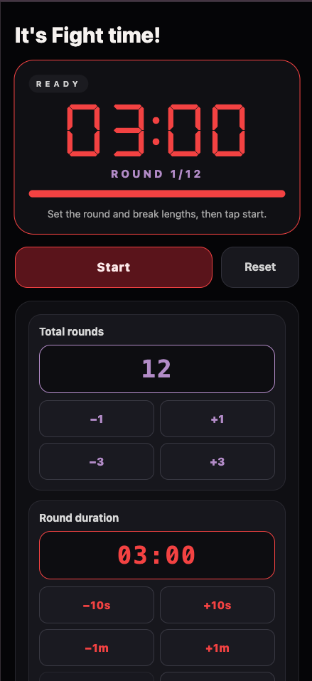
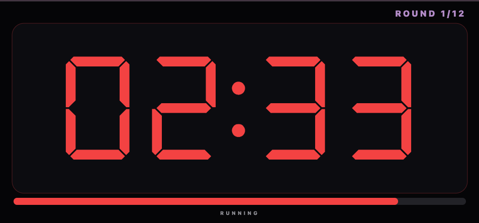
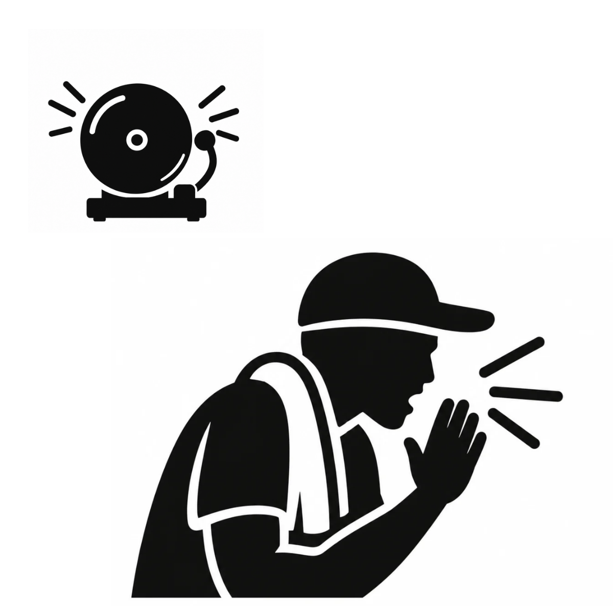

# Fight Time

Fight Time is a boxing interval timer designed for structured training sessions.

## Android Beta

Download the latest beta release:

[Download the latest Android APK](../../releases/latest)

## Features

- Configurable rounds and rest periods
- Round timer with audio signals
- Rest timer with audio signals
- Pause, resume and reset controls
- Workout completion message
- Optional anonymous usage analytics

## Screenshots

## Installation

1. Open the latest release on an Android device.
2. Download the APK file.
3. Open the downloaded file.
4. Allow installation from unknown sources if Android asks for permission.
5. Install and open Fight Time.

This is a beta release for testing purposes.
Commit message
Add Fight Time beta release assets
Release title
Fight Time v1.0.0-beta.1
Release notes
## Fight Time Android Beta

This is the first beta release of Fight Time, a boxing interval timer for Android.

### Included

- Configurable round and rest durations
- Round and rest countdown timers
- Audio cues for round transitions
- Ten-second audio announcements
- Pause, resume and reset controls
- Workout completion screen
- Optional anonymous usage analytics

### Installation

Download the APK attached to this release and install it on an Android device.

Android may ask you to allow installation from unknown sources.

### Important

This is a beta version intended for testing and feedback. S
